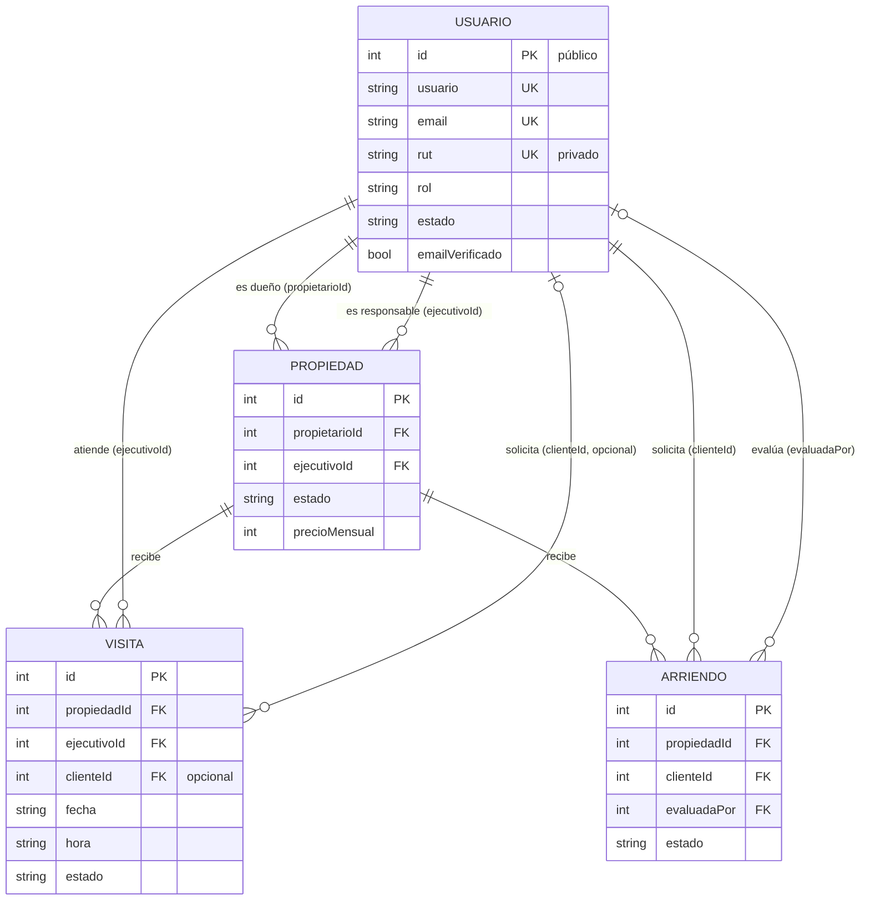

# Modelo lógico — Gestión Inmobiliaria

Este documento define el modelo de datos, los tipos de usuario, sus permisos y
las dependencias entre entidades que regirán la migración de `localStorage` a
MongoDB Atlas. Es la referencia para implementar modelos, rutas y validaciones
del backend, y para ajustar el frontend.

**Estado (2026-11-01):** migración completa, fases 1 a 7 (§10.8). Lo que quedó fuera del alcance académico está en §12.

> Convenciones
> - **`id` (Number, único) es el identificador público de cada documento.** Es el único que se expone en la API y se usa en las referencias entre entidades y en la lógica de negocio. `_id` de MongoDB es solo interno.
> - **El RUT es un dato privado**: nunca se usa como clave ni como referencia, no viaja en el JWT y no aparece en respuestas públicas (ver §3.1).
> - MongoDB no impone claves foráneas: **toda integridad referencial se valida en el servidor**. Los cambios que tocan más de un documento se hacen en una transacción (los clusters de Atlas son replica sets y la soportan).

---

## 1. Decisiones de diseño

| # | Tema | Decisión | Motivo |
|---|------|----------|--------|
| D1 | Propietario vs Usuario | **Fusionados**: todo dueño es un `Usuario` con `rol: 'propietario'`. | Una sola identidad; desaparece la colección `propietarios` y su `usuarioId` opcional. Todo dueño tiene cuenta. |
| D2 | Alta de propietarios | Puede registrarse, pero queda **`Pendiente`** y pasa por dos pasos **en orden**: (1) confirma su correo y (2) un ejecutivo o admin verifica su RUT y contrato. Ejecutivos y admin también pueden crearlos directamente. | Evita avisos fraudulentos, la autoasignación de privilegios, la toma de cuentas y los duplicados (ver §2.3). |
| D3 | Alcance del propietario | **Solo lo suyo**: gestiona sus propiedades y ve las visitas y solicitudes de ellas **sin datos de contacto ni financieros**. Da la **segunda aprobación** de los arriendos. | Mínimo privilegio y minimización de datos personales. |
| D4 | Admin vs ejecutivo | El ejecutivo opera el negocio. El admin hace lo mismo sobre cualquier propiedad, como suplente, y además **gestiona usuarios**. | Separar la operación de la administración del sistema. |
| D5 | Ejecutivo por propiedad | Cada propiedad tiene un **ejecutivo responsable fijo** (`ejecutivoId`). Los ejecutivos **ven** todas las propiedades, pero **operan** solo las de su cartera. | Responsabilidad clara; la agenda se calcula por ejecutivo. |
| D6 | Agenda | Visitas de **30 min** que empiezan en `:00` o `:30`, de **lunes a viernes de 09:00 a 18:00, excepto feriados**. No pueden chocar dos visitas en la misma propiedad, y un ejecutivo necesita **30 min de traslado** entre propiedades distintas. Toda visita tiene ejecutivo y propiedad disponibles. **Solo el ejecutivo aprueba visitas.** | Requisito del caso. |
| D7 | Visitas y arriendos | **Visita libre** (sin cuenta, solo datos de contacto). **Arriendo con cuenta** de cliente `Activo` (`clienteId` obligatorio). | Baja fricción para el interés inicial; identidad verificable para la evaluación financiera. |
| D8 | Aprobación de arriendos | **Doble aprobación**: primero el **ejecutivo responsable** (o el admin) evalúa los antecedentes y aprueba. Después el **propietario** acepta o rechaza. La solicitud solo queda `Aprobada` con ambas. | El dueño decide sobre su inmueble, pero el ejecutivo filtra antes los datos financieros, que el dueño no ve. |
| D9 | Disponible ≠ Publicada | `Disponible`: lista internamente, no visible al público. `Publicada`: visible y acepta solicitudes. `Reservada`: visible, sin nuevas solicitudes. `Arrendada`, `En mantención` e `Inactiva`: ocultas. Una propiedad creada por un propietario **nace `Disponible` y solo la publica el ejecutivo**. | Separa el inventario interno del catálogo público y evita avisos sin revisar. |
| D10 | Baja de propietario | **Baja lógica**: el usuario pasa a `Inactivo` y sus propiedades a `Inactiva`. El borrado físico solo procede si no tiene propiedades. | Conserva el historial. |
| D11 | Baja de propiedad | **Baja lógica**: pasa a `Inactiva` y sus visitas y solicitudes activas pasan a `Cancelada`. | Conserva el historial. `propiedadTitulo` va copiado en visitas y solicitudes. |
| D12 | Baja de ejecutivo | **Reasignación automática y proporcional** de su cartera entre los ejecutivos activos. Sus visitas y solicitudes activas vuelven a **`Pendiente`** para que el nuevo responsable las reprograme y evalúe. | Ninguna propiedad queda sin responsable y la carga no recae en un solo ejecutivo. |
| D13 | RUT | **Obligatorio y único para todo usuario** (cliente, propietario, ejecutivo y admin), con tratamiento privado. | Identidad verificable. Es un dato personal protegido por la Ley 19.628. |
| D14 | Activación por correo | Toda cuenta autorregistrada (cliente o propietario) queda **`Pendiente` hasta confirmar su correo** con un enlace de un solo uso. | Sin verificación de correo cualquiera puede registrarse con un email ajeno. |
| D15 | Plazo del propietario | Una solicitud en `Esperando propietario` **vence a los 5 días hábiles** (lunes a viernes, sin feriados) sin respuesta: pasa a `Vencida` y se **notifica por correo al ejecutivo responsable y a los admins**. `Vencida` **no es definitiva**: el cliente puede reactivarla. | El cliente no queda esperando indefinidamente y no pierde su postulación. |
| D17 | Edición de avisos publicados | Si el **propietario** cambia cualquier dato de una propiedad `Publicada`, vuelve a `Disponible` hasta que el ejecutivo la publique de nuevo. Una propiedad `Reservada` o `Arrendada` es de **solo lectura** para el propietario. | Ningún aviso cambia sin revisión, y no se alteran condiciones comprometidas con un cliente. |
| D18 | Datos públicos | El público ve la **comuna** y la ubicación general, pero **no la dirección exacta ni el dueño**. El contacto visible es el **ejecutivo responsable** (solo su nombre). La dirección la ven los internos, el dueño y el cliente con una visita `Confirmada` a esa propiedad (D20). | Reduce el riesgo de robos y de visitas sin agendar, y protege al dueño. |
| D19 | Fin de contrato | Al pasar de `Arrendada` a `Disponible`, la solicitud `Aprobada` pasa a **`Finalizada`**. | Conserva el historial y libera el índice de una sola `Aprobada` por propiedad (RN-08) para el siguiente arrendatario. |
| D20 | Aviso de visitas | Al **confirmar** una visita se envía un correo a quien la pidió, con fecha, hora, **dirección exacta** y ejecutivo. También se avisa por correo al rechazarla, al reprogramarla o cuando un interno la cancela. | Quien agenda sin cuenta no tiene otra forma de recibir la dirección (D18). |
| D21 | Plazos de agenda | El público y los clientes agendan **desde el día hábil siguiente** y **hasta 30 días corridos** (`DIAS_AGENDA`). Los internos pueden agendar o reprogramar desde hoy, en un horario que aún no pase. | El ejecutivo tiene tiempo de confirmar antes de la visita. |
| D22 | Visitas repetidas | Un mismo correo no puede tener **dos visitas activas** (`Pendiente` o `Confirmada`) en la misma propiedad. | Evita spam y reservas duplicadas de agenda. |
| D23 | Pendientes vencidas | Un proceso horario del servidor **cancela las visitas `Pendiente` cuya hora ya pasó** sin que nadie las confirmara. | No quedan pendientes eternas ni bloques ocupados. |
| D24 | Otras solicitudes al reservar | Al aceptar el dueño una solicitud, las demás no finalizadas de esa propiedad pasan a `Rechazada` ("Propiedad reservada para otro postulante") y se avisa a cada cliente. | Nadie queda esperando algo que no va a ocurrir. |
| D25 | Visita previa | **No** se exige haber visitado la propiedad para postular. | Menos fricción; el ejecutivo ve las visitas del cliente en su cartera. |
| D26 | Correos del arriendo | Al **propietario**, cuando le toca responder (con el plazo). Al **cliente**, cuando su solicitud queda `Aprobada`, `Rechazada` o `Vencida`. Al **ejecutivo**, cuando el propietario responde. Al ejecutivo y a los admins, cuando vence. | Avisos solo en los hitos que piden acción. |
| D27 | Desistir de una aprobada | El cliente no cancela en línea una solicitud `Aprobada`; solo el ejecutivo o el admin liberan la reserva. | El ejecutivo conoce el motivo antes de volver a publicar. |
| D28 | Paneles por rol | Todo usuario tiene panel en `/dashboard`: el **cliente** ve "Mi panel" (próximas visitas y solicitudes por reactivar); el **propietario**, sus propiedades; el **ejecutivo**, su cartera; el **admin**, todo el portafolio. | Cada uno ve solo lo que le compete, y al iniciar sesión todos llegan a su panel. |
| D29 | Métricas de ingreso | "Arriendo vigente" = suma del precio de las `Arrendada`; "Arriendo potencial" = suma de las `Publicada` y `Reservada`. Las `Inactiva`, `Disponible` y `En mantención` no suman. | Distingue lo que se cobra hoy de lo que podría cobrarse. |
| D30 | Datos de demostración | Un solo aviso en el pie de página: "Proyecto académico: los datos precargados son ficticios". | Transparencia sin recargar cada página. |
| D16 | Cuentas no activadas | Las cuentas que **no confirman su correo en 14 días se eliminan** automáticamente (índice TTL). | Libera email, usuario y RUT tomados por registros abandonados o falsos. |

---

## 2. Tipos de usuario

### 2.1 Actores

| Actor | Cómo se obtiene | Función en la webapp |
|-------|-----------------|----------------------|
| **Visitante** | Sin sesión | Explora el catálogo público y agenda visitas dejando nombre, email y teléfono. |
| **Cliente `Pendiente`** | Se registra en `/registro` | Cuenta sin confirmar. No puede iniciar sesión; puede pedir que se reenvíe el enlace de activación. |
| **Cliente `Activo`** | Confirma su correo | Interesado en arrendar. Agenda visitas, envía solicitudes de arriendo con sus antecedentes y sigue sus visitas y solicitudes ("Mis visitas", "Mis solicitudes"). |
| **Propietario `Pendiente`** | Se registra como propietario | Si no confirmó su correo, no puede iniciar sesión. Si ya lo confirmó, inicia sesión y ve el aviso "cuenta en verificación", sin permisos de gestión. |
| **Propietario `Activo`** | Correo confirmado y verificación del ejecutivo, o alta directa por un ejecutivo o admin | Dueño de inmuebles. Da de alta y mantiene sus propiedades, sigue el interés que generan y da la aprobación final de los arriendos. |
| **Ejecutivo** | Lo crea un admin | Opera el negocio: verifica propietarios, publica las propiedades de su cartera, atiende su agenda de visitas y da la primera aprobación de los arriendos de su cartera. Ve todas las propiedades. |
| **Admin** | Lo crea otro admin (el primero sale del seed) | Puede hacer todo lo del ejecutivo sobre cualquier propiedad, como suplente. Además gestiona usuarios y hace borrados físicos. |

### 2.2 Estados de cuenta

```
                 ┌─ cliente: (1) confirma correo ───────────────────────────────────┐
(registro) ─▶ Pendiente                                                             ▼
                 └─ propietario: (1) confirma correo ─▶ (2) verifica ejecutivo ─▶ Activo ◀──▶ Inactivo
Pendiente ──(rechazo de verificación)──▶ Inactivo
Pendiente sin correo confirmado a los 14 días ──▶ (eliminada)
(alta por ejecutivo o admin) ───────────────────────────────────────────────▶ Activo
```

| Campo | Cliente | Propietario | Ejecutivo / Admin |
|-------|---------|-------------|-------------------|
| `emailVerificado` | Requisito para `Activo` | Requisito para `Activo` | `true` al crearlo |
| `verificadoPor` | — | Requisito para `Activo`. El ejecutivo solo puede verificar **después** de que el correo esté confirmado | — |
| Login con `Pendiente` | ❌ "Activa tu cuenta desde tu correo" + reenviar | Con correo sin confirmar: ❌. Con correo confirmado: ✅, solo ve un aviso | — |

- Enlace de activación: token aleatorio que se guarda **hasheado**, vence en 24 h y se usa una sola vez. Reenviarlo invalida el anterior.
- Una cuenta con `emailVerificado: false` se elimina a los 14 días de `createdAt` (RN-20). No puede tener referencias, porque sin sesión no crea propiedades ni solicitudes, así que el borrado no deja huérfanos. Un propietario que ya confirmó su correo y espera la verificación del ejecutivo **no** se elimina.
- Un usuario `Inactivo` no puede iniciar sesión. **El middleware consulta el usuario en cada petición** (estado y pertenencia): si solo leyera el JWT, alguien dado de baja seguiría operando hasta 8 h.
- Un ejecutivo puede desactivar o reactivar propietarios y clientes. Solo el admin puede hacerlo con ejecutivos y admins.
- Siempre debe quedar al menos un admin `Activo`, y un admin no puede desactivarse a sí mismo.

### 2.3 Por qué el registro de propietario no se activa solo

1. **Fraude**: el propietario activo crea propiedades. Si bastara con registrarse, cualquiera podría ofrecer un inmueble ajeno y cobrar garantías.
2. **Toma de cuentas**: sin verificación, quien se registre primero con el correo o el RUT del dueño se quedaría con sus propiedades y con los datos de sus interesados.
3. **Autoasignación de privilegios**: elegir el rol en un formulario público es una escalada de privilegios.
4. **La relación nace de un contrato**: ser propietario para la inmobiliaria implica un mandato de administración firmado, y ese acto lo registra un ejecutivo.
5. **Duplicados**: un dueño ya cargado por un ejecutivo podría registrarse con otro correo. Se evita con RUT único y verificado.

---

## 3. Entidades (colecciones)

### 3.1 `usuarios`

| Campo | Tipo | Reglas |
|-------|------|--------|
| `id` | Number | **Identificador público**; único y obligatorio |
| `usuario` | String | Único, en minúsculas, obligatorio |
| `nombre` | String | Obligatorio. Para un propietario puede ser persona o empresa |
| `email` | String | Único, en minúsculas, obligatorio |
| `rut` | String | **Obligatorio y único para todos los roles.** Se guarda normalizado (`12345678-5`) y se valida con dígito verificador (módulo 11). **`select: false`** |
| `password` | String | Hash bcrypt; `select: false` |
| `telefono` | String | Opcional |
| `rol` | enum | `admin` · `ejecutivo` · `propietario` · `cliente` |
| `estado` | enum | `Pendiente` · `Activo` · `Inactivo` |
| `emailVerificado` | Boolean | `false` al autorregistrarse |
| `tokenVerificacion` | String | Hash del token de activación; `select: false` |
| `tokenExpira` | Date | |
| `verificadoPor` | Number → `usuarios.id` | Solo propietarios: ejecutivo o admin que lo activó |
| `createdAt` / `updatedAt` | Date | Automáticos |

Índices: `id`, `usuario`, `email` y `rut` únicos; `{ rol, estado }`; **TTL** `{ createdAt: 1 }` con `expireAfterSeconds: 1209600` (14 días) y `partialFilterExpression: { emailVerificado: false }`.

**Quién ve el RUT**: el propio usuario (en su perfil), los ejecutivos (de clientes y propietarios, para verificar identidad) y el admin. Nunca lo ven el propietario respecto de clientes, ni un visitante, ni ningún listado público. Lo cargan el usuario al registrarse, o el ejecutivo o admin al darlo de alta. Después solo lo corrigen un ejecutivo (clientes y propietarios) o el admin (cualquiera), porque es un dato verificado.

### 3.2 `propiedades`

| Campo | Tipo | Reglas |
|-------|------|--------|
| `id` | Number | Único |
| `titulo`, `tipo`, `comuna`, `direccion`, `ubicacion` | String / enum | Como hoy |
| `precioMensual`, `gastosComunes`, `superficie`, `dormitorios`, `banos`, `estacionamientos` | Number | Como hoy (≥ 0; precio y superficie ≥ 1) |
| `caracteristicas` | [String] | |
| `imagen` | String | URL |
| `estado` | enum | `Disponible` · `Publicada` · `Reservada` · `Arrendada` · `En mantención` · `Inactiva` |
| `propietarioId` | Number → `usuarios.id` | **Obligatorio**; debe ser un usuario `propietario` |
| `ejecutivoId` | Number → `usuarios.id` | **Obligatorio**; debe ser un ejecutivo `Activo` |
| `createdAt` / `updatedAt` | Date | |

Índices: `id` único; `propietarioId`; `ejecutivoId`; `{ estado, comuna, precioMensual }` para el catálogo público.

### 3.3 `visitas`

| Campo | Tipo | Reglas |
|-------|------|--------|
| `id` | Number | Único |
| `propiedadId` | Number → `propiedades.id` | Obligatorio |
| `propiedadTitulo` | String | Copia al crear (conserva el historial) |
| `ejecutivoId` | Number → `usuarios.id` | **Obligatorio**; se copia de `propiedad.ejecutivoId` al crear |
| `clienteId` | Number → `usuarios.id` | Opcional: se llena si la pide un cliente con sesión |
| `nombre`, `email`, `telefono` | String | Contacto obligatorio (nombre y email) |
| `fecha` | String `YYYY-MM-DD` | Hora local de Chile; de lunes a viernes, sin feriados |
| `hora` | String `HH:mm` | Solo `:00` o `:30`, entre 09:00 y 17:30 |
| `comentarios` | String | |
| `estado` | enum | `Pendiente` · `Confirmada` · `Rechazada` · `Cancelada` · `Realizada` |
| `resultado` | enum | `''` · `Interesado en arrendar` · `Pedirá antecedentes` · `No le interesó` · `Reprogramará` |
| `reasignada` | Boolean | `true` si volvió a `Pendiente` por la baja de un ejecutivo (D12) |
| `createdAt` / `updatedAt` | Date | Reemplazan `creadaEn` |

Índices: `id` único; `{ ejecutivoId, fecha }` y `{ propiedadId, fecha }` para calcular choques; `clienteId`.

### 3.4 `arriendos` (solicitudes de arriendo)

| Campo | Tipo | Reglas |
|-------|------|--------|
| `id` | Number | Único |
| `propiedadId` | Number → `propiedades.id` | Obligatorio |
| `propiedadTitulo` | String | Copia al crear |
| `clienteId` | Number → `usuarios.id` | **Obligatorio**; cliente `Activo` |
| `clienteNombre`, `clienteEmail`, `clienteTelefono` | String | Contacto de la solicitud; se rellenan desde la cuenta |
| `ingresoMensual` | Number | Dato financiero (privado) |
| `garantia`, `antecedentes` | String | Dato financiero (privado) |
| `estado` | enum | `Pendiente` · `En evaluación` · `Esperando propietario` · `Aprobada` · `Rechazada` · `Vencida` · `Cancelada` · `Finalizada` (D19) |
| `venceEn` | Date | Se fija al pasar a `Esperando propietario`: +5 días hábiles (RN-19) |
| `observacionesEjecutivo` | String | Interno; el propietario no lo ve |
| `motivo` | enum | Valores de `MOTIVOS_ARRIENDO`. Es la recomendación que ve el propietario |
| `evaluadaPor` / `evaluadaEn` | Number → `usuarios.id` / Date | Primera aprobación (ejecutivo o admin) |
| `respuestaPropietarioEn` | Date | Segunda aprobación o rechazo del propietario |
| `motivoPropietario` | String | Opcional, si el propietario rechaza |
| `createdAt` / `updatedAt` | Date | Reemplazan `creadaEn` |

Índices: `id` único; `clienteId`; `propiedadId`; **único parcial `{ propiedadId }` con `estado: 'Aprobada'`** (máximo una aprobada por propiedad); `{ estado, venceEn }` para el proceso de vencimiento.

### 3.5 Lo que no es colección

- **Clientes** (página `/clientes`): vista calculada a partir de visitas y arriendos.
- **Propietarios** (página `/propietarios`): vista de `usuarios` con `rol: propietario`.
- **Roles y valores permitidos**: constantes compartidas (`roles.js`, `flujo.js`).
- **Sesión**: JWT con `{ id, rol }`. Las cookies `gu_` son preferencias del navegador.

---

## 4. Diagrama entidad-relación



Cardinalidades:
- Propietario 1 ── 0..N Propiedad. Una propiedad tiene exactamente un dueño.
- Ejecutivo 1 ── 0..N Propiedad (su cartera). Una propiedad tiene exactamente un responsable.
- Propiedad 1 ── 0..N Visita · Ejecutivo 1 ── 0..N Visita · Cliente 0..1 ── 0..N Visita.
- Propiedad 1 ── 0..N Arriendo · Cliente 1 ── 0..N Arriendo · Propiedad 1 ── 0..1 Arriendo `Aprobada`.

---

## 5. Ciclos de vida

### 5.1 Propiedad

| Transición | Quién | Condición |
|------------|-------|-----------|
| (alta) → `Disponible` | Propietario activo, ejecutivo, admin | Siempre nace interna, oculta del catálogo |
| `Disponible` → `Publicada` | Ejecutivo responsable, admin | Propietario `Activo` y ejecutivo `Activo` |
| `Publicada` → `Disponible` | Ejecutivo responsable, admin | Despublicar |
| `Publicada` → `Reservada` | **Automático** con la segunda aprobación del arriendo | En la misma transacción |
| `Reservada` → `Publicada` | **Automático** al liberar la reserva | La solicitud aprobada pasa a `Cancelada` |
| `Reservada` → `Arrendada` | Ejecutivo responsable, admin | Contrato firmado |
| `Arrendada` → `Disponible` | Ejecutivo responsable, admin | Fin del contrato; la solicitud `Aprobada` pasa a `Finalizada` (D19) |
| `Publicada` → `Disponible` por edición | **Automático** si el propietario edita datos | D17 |
| `Disponible` / `Publicada` ↔ `En mantención` | Propietario (las suyas), ejecutivo responsable, admin | |
| cualquiera → `Inactiva` | Propietario (las suyas), ejecutivo responsable, admin | **No** si está `Reservada` o `Arrendada` (ver §7) |
| `Inactiva` → `Disponible` | Ejecutivo responsable, admin | Propietario `Activo` |

Las visitas y solicitudes activas solo se cancelan solas con la baja (`Inactiva`). En los demás cambios de estado se conservan y decide el ejecutivo.

### 5.2 Visita

| Transición | Quién |
|------------|-------|
| (alta) → `Pendiente` | Visitante, cliente, ejecutivo (en nombre de un tercero), admin |
| `Pendiente` → `Confirmada` / `Rechazada` | **Ejecutivo asignado** o admin. Al confirmar se revalidan los choques (RN-03 y RN-04) |
| `Pendiente` / `Confirmada` → `Cancelada` | Cliente (si es suya), ejecutivo asignado, admin |
| `Confirmada` → `Realizada` (+ `resultado`) | Ejecutivo asignado, admin |
| Reprogramar (`fecha`/`hora`) | Ejecutivo asignado, admin; se revalidan los choques |
| `Confirmada` → `Pendiente` (`reasignada: true`) | **Automático** por la baja del ejecutivo (D12) |

El propietario no confirma, rechaza ni cancela visitas: solo las ve. El visitante sin cuenta no puede cancelar en línea porque no hay una identidad que verificar.

### 5.3 Solicitud de arriendo (doble aprobación)

```
Pendiente ─▶ En evaluación ─▶ Esperando propietario ─▶ Aprobada ─▶ (liberar) Cancelada
 ▲  │              │                    │ └─(5 días hábiles sin respuesta)─▶ Vencida
 └──┼──────────────┼────────────────────┼──────(el cliente reactiva)─────────┘
    └──────────────┴─▶ Rechazada ◀──────┘ (rechaza el ejecutivo o el propietario)
    └──────────────┴────────────────────┴─▶ Cancelada (cliente, ejecutivo, admin)
```

| Transición | Quién |
|------------|-------|
| (alta) → `Pendiente` | Cliente `Activo`, propiedad `Publicada` |
| `Pendiente` → `En evaluación` | Ejecutivo responsable, admin |
| `Pendiente` / `En evaluación` → `Esperando propietario` | Ejecutivo responsable o admin: **primera aprobación**, con `motivo`. Se fija `venceEn` |
| `Esperando propietario` → `Vencida` | **Automático** al cumplirse `venceEn`. Se notifica por correo al ejecutivo responsable, a los admins activos y al **cliente** (con enlace a "Mis solicitudes" para reactivarla) |
| `Vencida` → `Pendiente` | **Cliente** (si es suya): reactiva la solicitud. **Se borra la primera aprobación** (`evaluadaPor`, `evaluadaEn`, `venceEn`, `motivo`) y el ejecutivo la evalúa de nuevo, por si cambiaron los antecedentes. Sin límite de reactivaciones. Requiere que la propiedad siga `Publicada` y que el cliente no tenga otra solicitud activa para ella (RN-07) |
| `Vencida` → `Cancelada` | Cliente (si es suya), ejecutivo responsable, admin |
| `Pendiente` / `En evaluación` → `Rechazada` | Ejecutivo responsable, admin (con `motivo`) |
| `Esperando propietario` → `Aprobada` | **Propietario** de la propiedad: **segunda aprobación**. La propiedad pasa a `Reservada` |
| `Esperando propietario` → `Rechazada` | Propietario (con `motivoPropietario` opcional) |
| `Pendiente` / `En evaluación` / `Esperando propietario` → `Cancelada` | Cliente (si es suya), ejecutivo responsable, admin |
| `Aprobada` → `Cancelada` (liberar reserva) | Ejecutivo responsable, admin. La propiedad vuelve a `Publicada` |
| `Aprobada` → `Finalizada` | **Automático** al terminar el contrato (`Arrendada` → `Disponible`, D19) |
| `En evaluación` / `Esperando propietario` → `Pendiente` | **Automático** por la baja del ejecutivo (D12); se borra la primera aprobación |

- El propietario decide con la recomendación del ejecutivo (`motivo`) y sin ver ingresos, antecedentes ni datos de contacto.
- Varias solicitudes de la misma propiedad pueden estar en `Esperando propietario`. Cuando el dueño aprueba una, **las demás no finalizadas pasan a `Rechazada`** con el motivo "Propiedad reservada para otro postulante" y cada cliente recibe un correo (D24), en la misma transacción que la reserva (RN-09). RN-08 sigue como respaldo.
- El cliente **no desiste en línea** de una solicitud `Aprobada`: se comunica con el ejecutivo, que libera la reserva (D27).

---

## 6. Reglas de negocio

**Agenda**

- **RN-01** Una visita dura 30 min y empieza en `:00` o `:30`, de lunes a viernes **excepto feriados**, entre 09:00 y 17:30 (último inicio). Los parámetros viven en `backend/config/constantes.js`: `AGENDA` (duración, traslado y horario) y `FERIADOS` (lista anual de feriados de Chile; se actualiza cada año).
- **RN-02** Solo se pueden agendar visitas en propiedades `Publicada`, con propietario y ejecutivo `Activo`.
- **RN-03** Choque por propiedad: dos visitas activas (`Pendiente` o `Confirmada`) en la misma propiedad deben cumplir `|Δinicio| ≥ 30 min`.
- **RN-04** Choque por ejecutivo: entre dos visitas activas del mismo ejecutivo debe haber `|Δinicio| ≥ 30 min` si son en la misma propiedad y `|Δinicio| ≥ 60 min` (30 de visita + 30 de traslado) si son en propiedades distintas.
- **RN-05** RN-03 y RN-04 se validan en el servidor dentro de una transacción al **crear, reprogramar y confirmar**. Las visitas `reasignada` pueden chocar temporalmente: el nuevo ejecutivo no puede confirmarlas sin resolver el choque.

**Arriendos**

- **RN-06** Solo un cliente `Activo` con sesión puede solicitar un arriendo, y solo en una propiedad `Publicada`.
- **RN-07** Un cliente tiene como máximo una solicitud activa (`Pendiente`, `En evaluación` o `Esperando propietario`) por propiedad. Se valida en el servidor. `Vencida`, `Rechazada` y `Cancelada` no cuentan como activas: el cliente puede reactivar una `Vencida` (§5.3) o volver a postular.
- **RN-08** Una propiedad tiene como máximo una solicitud `Aprobada` (índice único parcial).
- **RN-09** La segunda aprobación y la reserva de la propiedad, o la liberación y la nueva publicación, ocurren en **una sola petición y una sola transacción**.
- **RN-10** El propietario solo puede responder solicitudes `Esperando propietario` de **sus** propiedades, y solo si su cuenta está `Activo`.

**Propiedades y usuarios**

- **RN-11** `propietarioId` debe apuntar a un usuario `propietario`, y `ejecutivoId` a un `ejecutivo` `Activo`.
- **RN-12** Si un propietario crea una propiedad, el servidor le asigna el ejecutivo activo con **menor carga**. La carga es la cantidad de propiedades no `Inactiva` en su cartera; si hay empate, gana el `id` menor. Si la crea un ejecutivo, queda en su propia cartera.
- **RN-13** Un propietario no puede cambiar `propietarioId`, `ejecutivoId` ni los estados comerciales (`Publicada`, `Reservada`, `Arrendada`).
- **RN-14** El RUT es obligatorio, único y tiene un dígito verificador válido en todo usuario. Nunca se incluye en el JWT, en logs ni en respuestas que no estén autorizadas a verlo (§3.1).
- **RN-15** Las referencias entre entidades y los parámetros de ruta usan siempre `id` numérico, nunca el RUT ni el email.

**Reasignación proporcional (D12)**

- **RN-16** Al dar de baja a un ejecutivo, su cartera se recorre por `id` de propiedad y cada propiedad se asigna al ejecutivo activo con **menor carga en ese momento**, recalculada después de cada asignación. Si hay empate, gana el `id` menor. Así la diferencia de carga entre ejecutivos queda en una propiedad como máximo y nadie recibe toda la cartera.
  *Ejemplo:* E1 se da de baja con 6 propiedades; E2 tiene 3 y E3 tiene 1. El reparto queda E3 +4 y E2 +2, y ambos terminan con 5.
- **RN-17** En la misma transacción, las visitas futuras activas de esas propiedades pasan al nuevo responsable con `estado: 'Pendiente'` y `reasignada: true`. Las solicitudes `En evaluación` o `Esperando propietario` vuelven a `Pendiente` y se borra la primera aprobación. Las solicitudes `Aprobada` no cambian.
- **RN-18** La baja se bloquea si no queda ningún otro ejecutivo `Activo`.

**Procesos automáticos**

- **RN-19** *Vencimiento*: `venceEn` = momento de la primera aprobación + 5 días hábiles (lunes a viernes, sin `FERIADOS`); al reactivar una `Vencida` vuelve a `Pendiente` y el plazo corre desde la nueva aprobación. Un proceso periódico del servidor (cada hora) pasa a `Vencida` toda solicitud con `estado: 'Esperando propietario'` y `venceEn ≤ ahora`, y envía un correo al ejecutivo responsable, a todos los admins `Activo` y al cliente. Se marca `Vencida` **antes** de enviar el correo, para que un fallo de envío no repita el vencimiento.
- **RN-20** *Limpieza de cuentas*: el índice TTL de §3.1 elimina las cuentas con `emailVerificado: false` a los 14 días. MongoDB revisa los TTL cada 60 s, así que no requiere un proceso propio.

---

## 7. Dependencias: qué pasa cuando algo se da de baja

| Evento | Efecto en cascada | Bloqueo |
|--------|-------------------|---------|
| **Baja de propietario** (`Inactivo`) | Sus propiedades pasan a `Inactiva`. Las visitas activas y las solicitudes no finalizadas de esas propiedades pasan a `Cancelada`. | Se bloquea si tiene propiedades `Reservada` o `Arrendada` (compromisos vigentes con terceros). |
| **Rechazo de verificación** | `Pendiente` → `Inactivo`. Sin efectos, porque un propietario pendiente no tiene propiedades. | — |
| **Borrado físico de propietario** | — | Solo el admin, y solo si no tiene propiedades. |
| **Baja de propiedad** (`Inactiva`) | Las visitas activas y las solicitudes no finalizadas pasan a `Cancelada`. | Se bloquea si está `Reservada` o `Arrendada`. |
| **Borrado físico de propiedad** | — | Solo el admin, y solo si no tiene visitas ni solicitudes. |
| **Baja de ejecutivo** | Reasignación proporcional de su cartera (RN-16). Visitas y solicitudes vuelven a `Pendiente` (RN-17). | Se bloquea si no queda otro ejecutivo `Activo` (RN-18). |
| **Baja de cliente** | Sus visitas futuras activas y sus solicitudes no finalizadas pasan a `Cancelada`. Una solicitud `Aprobada` se mantiene y la resuelve el ejecutivo. | — |
| **Borrado físico de usuario** | — | Solo el admin, y solo si no está referenciado en ningún documento. |
| **Cuenta sin correo confirmado a los 14 días** | Se elimina (TTL). Sin efectos, porque no tiene referencias. | — |
| **Solicitud vencida** (`Vencida`) | Correo al ejecutivo responsable y a los admins. La propiedad no cambia (sigue `Publicada`). | — |

Visitas y solicitudes **no se borran físicamente**, salvo el admin.

---

## 8. Matriz de permisos

Leyenda: ✅ todas · **propias** solo las del usuario · **cartera** propiedades donde es `ejecutivoId` · ❌ sin acceso. Las cuentas `Pendiente` e `Inactivo` no tienen permisos de gestión.

| Acción | Visitante | Cliente | Propietario | Ejecutivo | Admin |
|--------|:---------:|:-------:|:-----------:|:---------:|:-----:|
| **Propiedades** | | | | | |
| Ver catálogo público (`Publicada`, `Reservada`) | ✅ | ✅ | ✅ | ✅ | ✅ |
| Ver propiedades no públicas y todos sus datos | ❌ | ❌ | propias | ✅ | ✅ |
| Crear propiedad (nace `Disponible`) | ❌ | ❌ | propias | ✅ (a su cartera) | ✅ |
| Editar datos | ❌ | ❌ | propias (RN-13) | cartera | ✅ |
| Publicar / despublicar / marcar arrendada | ❌ | ❌ | ❌ | cartera | ✅ |
| Mantención / baja lógica | ❌ | ❌ | propias | cartera | ✅ |
| Reasignar ejecutivo o propietario | ❌ | ❌ | ❌ | ❌ | ✅ |
| Borrado físico | ❌ | ❌ | ❌ | ❌ | ✅ |
| **Visitas** | | | | | |
| Agendar | ✅ | ✅ | ❌ | ✅ | ✅ |
| Ver | ❌ | propias | de sus propiedades: fecha, hora, estado y resultado, **sin contacto** | cartera | ✅ |
| Confirmar / rechazar / realizar / reprogramar | ❌ | ❌ | ❌ | asignadas | ✅ |
| Cancelar | ❌ | propias | ❌ | asignadas | ✅ |
| **Arriendos** | | | | | |
| Solicitar | ❌ | ✅ | ❌ | ❌ | ❌ |
| Ver | ❌ | propias | de sus propiedades: nombre, estado y `motivo`, **sin contacto ni datos financieros** | cartera | ✅ |
| Primera aprobación / rechazo | ❌ | ❌ | ❌ | cartera | ✅ |
| Segunda aprobación / rechazo | ❌ | ❌ | propias (`Esperando propietario`) | ❌ | ❌ |
| Liberar reserva | ❌ | ❌ | ❌ | cartera | ✅ |
| Cancelar | ❌ | propias (no `Aprobada`) | ❌ | cartera | ✅ |
| **Usuarios** | | | | | |
| Registrarse (queda `Pendiente`) | ✅ como cliente o propietario | — | — | — | — |
| Editar perfil propio (nombre, teléfono, contraseña) | ❌ | ✅ | ✅ | ✅ | ✅ |
| Ver su propio RUT | ❌ | ✅ | ✅ | ✅ | ✅ |
| Ver o corregir el RUT de otros | ❌ | ❌ | ❌ | clientes y propietarios | ✅ |
| Gestionar propietarios (alta, ficha, verificar, baja) | ❌ | ❌ | ❌ | ✅ | ✅ |
| Ver la cartera de clientes (`/clientes`) | ❌ | ❌ | ❌ | cartera | ✅ |
| Desactivar o reactivar clientes | ❌ | ❌ | ❌ | ✅ | ✅ |
| Crear, editar o desactivar ejecutivos y admins; cambiar roles | ❌ | ❌ | ❌ | ❌ | ✅ |
| Borrado físico de usuarios | ❌ | ❌ | ❌ | ❌ | ✅ |

Matrices resultantes para `roles.js`, compartidas entre frontend y backend:

```js
ROLES_INTERNOS = ['admin', 'ejecutivo'];                // propietarios, clientes, publicar, 1ª aprobación (por cartera)
ROLES_GESTION  = ['admin', 'ejecutivo', 'propietario']; // crear/editar propiedades (por propiedad o cartera)
ROLES_ADMIN    = ['admin'];                             // usuarios internos, reasignar, borrado físico
ROLES_REGISTRO = ['cliente', 'propietario'];            // autorregistro (queda Pendiente)
```

La comprobación por rol es solo la primera barrera. **Cada ruta debe además filtrar por pertenencia**: `propietarioId === usuario.id` para el propietario, `ejecutivoId === usuario.id` para el ejecutivo y `clienteId === usuario.id` para el cliente. También debe **proyectar los campos según el rol**: sin contacto ni datos financieros para el propietario y sin RUT fuera de §3.1.

---

## 9. Estado actual vs modelo (revisión al 2026-10-31)

### 9.1 Backend (`backend/`, sin commit)

| # | Archivo | Estado actual | Cambio requerido |
|---|---------|---------------|------------------|
| B1 | `models/Usuario.js` | Faltan `rut`, `estado`, `emailVerificado`, `tokenVerificacion`, `tokenExpira` y `verificadoPor` | Agregarlos (§3.1). `rut` y los campos del token con `select: false` |
| B2 | `models/Propiedad.js` | `propietarioId` opcional (`default: null`); no existe `ejecutivoId` | Ambos obligatorios (§3.2) |
| B3 | — | No existen modelos ni rutas de visitas y arriendos | Crear `Visita` y `Arriendo` con sus rutas (§3.3, §3.4, §5.2, §5.3) |
| B4 | `routes/propiedades.js` | `GET /` devuelve **todas** las propiedades en todos sus estados a cualquiera | Público: `Publicada` y `Reservada`. Propietario: las suyas. Internos: todas |
| B5 | `routes/propiedades.js` | PATCH y DELETE sin comprobar pertenencia; el propietario puede editar o borrar cualquier propiedad y cambiar `estado`, `propietarioId` o `ejecutivoId` | Comprobar dueño o cartera y aplicar RN-13 |
| B6 | `routes/propiedades.js` | `DELETE` hace borrado físico | Baja lógica con cascada (§7); borrado físico solo para el admin |
| B7 | `routes/propiedades.js` | `POST` no asigna ejecutivo ni fuerza `Disponible` | RN-12 y estado inicial `Disponible` |
| B8 | `routes/auth.js` | El registro no pide RUT y activa la cuenta al instante | RUT con módulo 11, estado `Pendiente`, envío del enlace de activación |
| B9 | `routes/auth.js` | Login no revisa `estado` ni `emailVerificado` | Aplicar las reglas de login de §2.2 |
| B10 | `routes/auth.js` | No existen `GET /verificar/:token` ni `POST /reenviar-verificacion` | Crearlos |
| B11 | `middleware/auth.js` | Confía solo en el JWT | Cargar el usuario en cada petición, rechazar si no está `Activo` y dejarlo en `req.usuario` |
| B12 | — | No hay rutas de usuarios (admin), de verificación de propietarios ni de reasignación | Crear `routes/usuarios.js` (§8, RN-16 a RN-18) |
| B13 | — | No hay servicio de correo | **Dependencia nueva** (`nodemailer` + SMTP o un proveedor como Resend o Brevo) y variables de entorno. Se usa para la activación (D14) y para avisar vencimientos (D15) |
| B14 | `seed.js` | Solo carga propiedades y usuarios, sin RUT ni `ejecutivoId` | Seed completo y coherente (§9.3) |
| B15 | `.env.example` | **Ya no está en el árbol de trabajo**; solo existe `.env` (ignorado por git) | Restaurarlo sin secretos y agregar las variables de correo y `FRONTEND_URL` (para el enlace de activación) |
| B16 | `server.js` | `cors()` acepta cualquier origen | Restringir a `FRONTEND_URL` |
| B17 | — | No hay transacciones | Usar `session.withTransaction` en RN-05, RN-09, la reasignación y las cascadas |
| B18 | — | No hay procesos periódicos | `setInterval` horario en `server.js` para el vencimiento (RN-19), más una función que calcule los días hábiles. Si algún día corre más de una instancia del servidor, moverlo a un Scheduled Trigger de Atlas |
| B19 | `models/Usuario.js` | Sin índice TTL | Índice TTL parcial (RN-20) |
| B20 | — | No hay endpoint de disponibilidad | `GET /api/propiedades/:id/horarios?fecha=` devuelve los bloques libres según RN-01 a RN-04, para que el formulario muestre solo horarios válidos |

### 9.2 Frontend (`frontend/src/`)

| # | Archivo | Estado actual | Cambio requerido |
|---|---------|---------------|------------------|
| F1 | `context/*` | Los cinco contextos usan `localStorage`; no hay ni un `fetch` ni `VITE_API_URL` | Consumir la API con el token JWT en `Authorization` |
| F2 | `context/PropietariosContext.jsx`, `data/propietarios.js` | Ficha de propietario separada con `usuarioId` | Eliminar; `/propietarios` lista usuarios con `rol: propietario` |
| F3 | `pages/Registro.jsx` | Ofrece el rol "Ejecutivo"; no pide RUT; inicia sesión al registrarse | Solo cliente o propietario, campo RUT y pantalla "revisa tu correo" sin iniciar sesión |
| F4 | — | No existe la página de activación | Ruta `/verificar/:token` y opción de reenviar el enlace en el login |
| F5 | `pages/Login.jsx` | No contempla cuentas `Pendiente` | Mostrar el mensaje de activación y el aviso de cuenta en verificación |
| F6 | `pages/Propiedades.jsx` | El catálogo muestra **todas** las propiedades, incluidas `Inactiva` y `Arrendada`; filtra al propietario a través de `propietarios.usuarioId` | Público: `Publicada` y `Reservada`. Propietario: `propietarioId === user.id` |
| F7 | `pages/DetallePropiedad.jsx` | Muestra Editar y Eliminar a todo `ROLES_GESTION`, aunque la propiedad no sea suya; el botón Eliminar borra físicamente | Mostrar según pertenencia; "Dar de baja" en lugar de eliminar |
| F8 | `pages/DetallePropiedad.jsx` | El formulario de visita acepta cualquier estado de propiedad, cualquier minuto y cualquier día | Solo `Publicada`; selector de bloques de 30 min de L a V, 09:00–17:30 |
| F9 | `pages/DetallePropiedad.jsx` | Muestra al público el nombre del dueño | Ocultarlo en la vista pública (minimización de datos) |
| F10 | `pages/DetallePropiedad.jsx`, `ArriendoNuevo.jsx` | Permiten arrendar en `Disponible` y `Publicada`; `/arriendos/nueva` acepta **cualquier rol** con sesión | Solo `Publicada` y solo `ROLES_CLIENTE` |
| F11 | `pages/Arriendos.jsx` | Una sola aprobación; liberar la reserva deja `Disponible`; aprobar hace dos escrituras separadas; botón de borrado físico; ve todas las solicitudes | Doble aprobación (§5.3), liberar a `Publicada`, una sola llamada a la API, filtro por cartera |
| F12 | `pages/Arriendos.jsx` | El propietario no tiene acceso | Vista del propietario: sus solicitudes sin datos privados y botones de segunda aprobación |
| F13 | `pages/Visitas.jsx` | `ROLES_ATENCION` incluye al propietario, que ve los datos de contacto y puede confirmar o rechazar | Propietario: solo lectura sin contacto. Ejecutivo: su cartera |
| F14 | `pages/Clientes.jsx` | Accesible al propietario | Solo internos, filtrado por cartera |
| F15 | `pages/Propietarios.jsx` | CRUD de fichas, accesible al propietario | Solo internos; alta con RUT, botón "Verificar" para cuentas `Pendiente`, baja lógica |
| F16 | `pages/Dashboard.jsx` | Muestra a **todo** usuario con sesión, incluido el cliente, las métricas globales (ingreso estimado, total de propiedades) y la tabla completa | Panel por rol: cliente (mis visitas y solicitudes), propietario (lo suyo), ejecutivo (su cartera), admin (global) |
| F17 | — | El cliente no tiene "Mis visitas" ni "Mis solicitudes" | Crear esas vistas (pueden vivir en el panel) |
| F18 | — | No hay administración de usuarios | Página para el admin: ejecutivos, roles, bajas y reasignación |
| F19 | `data/roles.js` | `ROLES_ATENCION` y `ROLES_EVALUAN` incluyen o excluyen roles según el modelo anterior | Reemplazar por las matrices de §8 |
| F20 | `data/flujo.js` | `ESTADOS_ARRIENDO` no incluye `Esperando propietario` ni `Vencida` | Agregarlos |
| F21 | `components/Header.jsx` | El menú se arma con las matrices antiguas | Ajustarlo a §8 |
| F22 | `pages/Privacidad.jsx`, `PoliticaCookies.jsx` | Dicen que los datos viven en `localStorage`; no mencionan el RUT ni el correo de activación | Actualizar: almacenamiento en servidor, tratamiento del RUT (Ley 19.628), correos transaccionales y eliminación a los 14 días de las cuentas no activadas |
| F23 | `pages/ArriendoNuevo.jsx` | **Defecto:** después de enviar, redirige a `/arriendos`, que exige `ROLES_EVALUAN`, así que el cliente cae en "No tienes permisos" | Redirigir a "Mis solicitudes" |
| F24 | `components/PropiedadForm.jsx` | **Defecto:** si `ubicacion` va vacía, se guarda `` `${comuna}, Santiago` ``, lo que da "Viña del Mar, Santiago" | Dejar `ubicacion` opcional sin inventar la región, o agregar el campo `region` |
| F25 | `pages/Visitas.jsx` | **Defecto:** "Marcar realizada" guarda `resultado: 'Interesado en arrendar'` si el ejecutivo no eligió uno, lo que infla las métricas de interés | Exigir un `resultado` explícito al cerrar la visita (validación en backend) |
| F26 | `pages/ArriendoNuevo.jsx`, `PropiedadForm.jsx` | Guardan textos de relleno como si fueran datos: `garantia: 'Por definir'`, `antecedentes: 'Sin antecedentes adjuntos'`, `imagen: IMAGEN_DEFECTO` | Guardar `''` y mostrar el texto o la imagen de respaldo solo al renderizar |
| F27 | `pages/ArriendoNuevo.jsx` | El cliente puede escribir un `clienteEmail` distinto al de su cuenta | Con `clienteId` obligatorio, el backend toma nombre y email de la cuenta; solo el teléfono es editable |

### 9.3 Seed

1. **Todos los usuarios necesitan RUT** (ficticio, con dígito verificador válido), `estado: 'Activo'` y `emailVerificado: true`.
2. **El catálogo público quedaría casi vacío**: 7 de las 12 propiedades están `Disponible` (ids 1, 2, 3, 5, 7, 9 y 11). Solo seguirían visibles la 6, la 12 y la 4 (`Reservada`). Las que se quieran mostrar deben pasar a `Publicada`.
3. **El propietario 5 (Grupo Patagonia) está `Inactivo`**, pero sus propiedades 9 y 10 siguen activas. Deben quedar `Inactiva`, o el propietario debe pasar a `Activo`.
4. **Cuatro de los cinco dueños no tienen cuenta.** Hay que crear usuarios `propietario` y reasignar `propiedades.propietarioId`: la ficha 1 corresponde al usuario 3 y las fichas 2 a 5 a usuarios nuevos.
5. **Hay un solo ejecutivo (id 2).** Conviene sembrar al menos tres para demostrar la reasignación proporcional, y repartir la cartera con `ejecutivoId`.
6. **Visitas**: tres tienen `ejecutivoId: null` (ids 2, 5 y 6) y las seis apuntan a propiedades no `Publicada` (la 2, a una `Reservada`). Hay que ajustarlas a RN-02 y RN-03/04.
7. **Arriendos**: las solicitudes 2 a 5 son de personas sin cuenta y necesitan un usuario `cliente` con RUT. Conviene sembrar una en `Esperando propietario` con `venceEn` futuro (doble aprobación) y otra con `venceEn` pasado (para que el proceso la venza al arrancar el servidor).
8. Sembrar un propietario `Pendiente` con el correo confirmado (para demostrar la verificación del ejecutivo) y un cliente `Pendiente` sin confirmar (para la activación). Este último lo borrará el TTL a los 14 días de su `createdAt`.

---

## 10. Auditoría: qué lógica migra del frontend al backend

Hoy **toda** la lógica de negocio vive en el navegador (contextos de React con `localStorage`). Eso significa que cualquier usuario puede saltársela editando su `localStorage` o llamando directamente a la API. Cada pieza se clasifica en uno de cuatro destinos:

- **Backend**: se mueve al servidor y el frontend la elimina.
- **Ambos**: el backend tiene la última palabra y el frontend la repite solo para dar respuesta inmediata en la interfaz (validación de formularios, ocultar botones).
- **Frontend**: se queda, porque es presentación o se calcula sobre datos que la API ya filtró por rol.
- **Eliminar**: deja de existir.

### 10.1 Autenticación y usuarios (`context/AuthContext.jsx`, `Registro.jsx`, `Login.jsx`)

| Lógica actual | Ubicación | Destino | Detalle |
|---------------|-----------|---------|---------|
| Comparar contraseña y validar el perfil en el login | `AuthContext.login` | **Backend** | Ya existe `POST /api/auth/login`; falta revisar el estado de la cuenta (B9) |
| Usuarios semilla con contraseñas en texto plano | `AuthContext` (`usuariosSemilla`) | **Eliminar** | Viven en `seed.js` con hash |
| Lista completa de usuarios cargada en el navegador (`usuarios`) | `AuthContext` | **Eliminar** | Hoy las cuentas del navegador, **con contraseña en texto plano**, quedan visibles en `gi_usuarios` y en el contexto. Los internos consultan `GET /api/usuarios` |
| Unicidad de usuario y email, normalización, generación de `id` | `AuthContext.registrar` | **Backend** | Ya existe; faltan RUT, estado `Pendiente` y el correo de activación |
| Validación del formulario de registro (obligatorios, largo de contraseña ≥ 6) | `Registro.jsx` | **Ambos** | "Confirmar contraseña" queda solo en el frontend |
| Validación del RUT (módulo 11) | — (no existe) | **Ambos** | Nueva |
| Sesión guardada en `gi_sesion` (objeto usuario) | `AuthContext` | **Frontend** | Pasa a guardar solo el token (`gi_token`); el usuario se obtiene de `GET /api/auth/yo`, que también refleja si la cuenta cambió de estado |
| Guardias por rol (`ProtectedRoute`, `puedeGestionar`, menú) | `App.jsx`, páginas, `Header.jsx` | **Ambos** | El frontend oculta; el backend autoriza por rol **y pertenencia** (B11) |
| Activación por correo, verificación del propietario, limpieza TTL | — | **Backend** | Nuevas (D14, D2, RN-20) |

### 10.2 Propiedades (`context/PropiedadesContext.jsx`, `Propiedades.jsx`, `DetallePropiedad.jsx`, `PropiedadForm.jsx`)

| Lógica actual | Ubicación | Destino | Detalle |
|---------------|-----------|---------|---------|
| Crear, editar y borrar; generación de `id` | `PropiedadesContext` | **Backend** | Ya existe; faltan pertenencia (B5), baja lógica (B6) y asignación de ejecutivo (B7) |
| `migrarPropiedades` (rellenar campos RF3 faltantes) | `PropiedadesContext` | **Eliminar** | Lo cubren los valores por defecto del schema |
| Filtrar las propiedades del propietario logueado | `Propiedades.jsx` (`basePropiedades`) | **Backend** | La API devuelve solo lo que corresponde al rol |
| Qué estados ve el público | — (hoy se muestran todos) | **Backend** | D9 |
| Filtros del catálogo (tipo, comuna, precio, dormitorios, baños) | `services/filtros.js` | **Frontend** | Con 12 propiedades basta filtrar en el cliente. Si el catálogo crece, se pasan a parámetros de consulta (el índice ya está previsto en §3.2) |
| Validación del formulario (título, comuna, precio > 0, superficie > 0, gastos ≥ 0) | `PropiedadForm.jsx` | **Ambos** | El schema ya valida; falta que el backend devuelva el error por campo |
| Armar el payload (`trim`, separar características, convertir a número) | `PropiedadForm.jsx` | **Frontend** | Es formato de entrada; el backend solo valida tipos |
| Valores inventados para `ubicacion` e `imagen` | `PropiedadForm.jsx` | **Eliminar** | F24 y F26 |
| Transiciones de estado comercial (publicar, despublicar, arrendar) | — (hoy un `<select>` libre) | **Backend** | Endpoints por acción que validan §5.1 y RN-13 |
| Nombre del dueño en el detalle | `DetallePropiedad.jsx` | **Backend** | La API proyecta los campos según el rol (F9) |
| Cascadas de baja (visitas y solicitudes a `Cancelada`) | — | **Backend** | Nueva (§7) |

### 10.3 Propietarios (`context/PropietariosContext.jsx`, `Propietarios.jsx`)

| Lógica actual | Ubicación | Destino | Detalle |
|---------------|-----------|---------|---------|
| CRUD de fichas separadas | `PropietariosContext` | **Backend** | Pasa a `/api/usuarios?rol=propietario` (D1). El contexto desaparece |
| Contar propiedades por dueño (`propiedadesDe`) | `Propietarios.jsx` | **Frontend** | Se calcula sobre la lista que reciben los internos |
| Verificar o rechazar una cuenta `Pendiente`, baja lógica con cascada | — | **Backend** | Nueva |

### 10.4 Visitas (`context/VisitasContext.jsx`, `Visitas.jsx`, `DetallePropiedad.jsx`)

| Lógica actual | Ubicación | Destino | Detalle |
|---------------|-----------|---------|---------|
| Detección de choques (`hayConflicto`, hoy global por fecha y hora) | `VisitasContext`, `Visitas.jsx` | **Backend** | Pasa a RN-03 y RN-04, dentro de una transacción. El frontend deja de calcularla y consulta los horarios libres (B20) |
| Valores iniciales al crear (`estado`, `resultado`, `ejecutivoId: null`, `creadaEn`, `id`) | `VisitasContext.crear` | **Backend** | `ejecutivoId` se copia de la propiedad; `createdAt` lo pone Mongoose |
| Cambios de estado (`actualizarEstado` acepta **cualquier** estado sin revisar el actual) | `VisitasContext`, `Visitas.jsx` | **Backend** | Hoy solo la interfaz oculta los botones que no corresponden; el contexto acepta cualquier transición. El backend valida §5.2 y quién la ejecuta |
| Reprogramar | `VisitasContext.actualizar` | **Backend** | Revalida los choques |
| Resultado por defecto al cerrar la visita | `Visitas.jsx` (`marcarRealizada`) | **Eliminar** | F25: el resultado pasa a ser obligatorio |
| Validación del formulario (nombre, email, fecha ≥ hoy, hora) | `DetallePropiedad.jsx` | **Ambos** | El backend agrega días hábiles, bloques de 30 min y propiedad `Publicada` |
| Borrar una visita | `VisitasContext.eliminar` | **Backend** | Solo el admin (§7) |
| Filtro por estado en la tabla | `Visitas.jsx` | **Frontend** | |
| Volver visitas a `Pendiente` al reasignar | — | **Backend** | Nueva (RN-17) |

### 10.5 Arriendos (`context/ArriendosContext.jsx`, `Arriendos.jsx`, `ArriendoNuevo.jsx`)

| Lógica actual | Ubicación | Destino | Detalle |
|---------------|-----------|---------|---------|
| Valores iniciales al crear, `id`, `creadaEn` | `ArriendosContext.crear` | **Backend** | `clienteId`, nombre y email salen del token (F27) |
| Revisar que la propiedad acepte solicitudes | `ArriendoNuevo.jsx` | **Ambos** | El backend aplica RN-06 y RN-07 |
| Aprobar = reservar la propiedad + aprobar la solicitud (**dos escrituras separadas**) | `Arriendos.jsx` (`aprobar`) | **Backend** | Una transacción (RN-09). Si falla la segunda escritura, hoy queda la propiedad reservada sin una solicitud aprobada |
| Liberar la reserva (vuelve a `Disponible`) | `Arriendos.jsx` (`liberarReserva`) | **Backend** | Vuelve a `Publicada`, en una transacción |
| En evaluación, rechazar, cancelar (sin revisar el estado actual) | `Arriendos.jsx` | **Backend** | Validan §5.3 |
| `evaluadaEn` y demás marcas de tiempo | `ArriendosContext.actualizarEstado` | **Backend** | Hoy se sobrescriben en cada cambio de estado, incluida la cancelación |
| Borrar una solicitud | `ArriendosContext.eliminar` | **Backend** | Solo el admin |
| Doble aprobación, plazo de 5 días hábiles, notificaciones | — | **Backend** | Nuevas (D8, D15, RN-19) |
| Filtro por estado en la tabla | `Arriendos.jsx` | **Frontend** | |

### 10.6 Vistas derivadas

| Lógica actual | Ubicación | Destino | Detalle |
|---------------|-----------|---------|---------|
| Cartera de clientes (agrupar visitas y solicitudes por email) | `Clientes.jsx` (`construirClientes`) | **Frontend** | Se calcula sobre datos que la API ya filtró por cartera |
| Métricas del panel | `Dashboard.jsx` | **Frontend** | También sobre datos filtrados por rol (F16). Ojo: "Ingreso estimado" suma `precioMensual` de **todas** las propiedades, incluidas las `Inactiva`; conviene definir qué mide antes de migrar |

### 10.7 Datos y servicios

| Pieza | Ubicación | Destino | Detalle |
|-------|-----------|---------|---------|
| Semillas (`propiedades`, `propietarios`, `visitas`, `arriendos`) | `data/*.js` | **Backend** | Mover a `backend/data/`. Hoy `seed.js` importa desde `../frontend`, lo que acopla los dos proyectos y falla si el backend se despliega solo |
| Versionado de la semilla (`prepararDatosDemo`, `VERSION_DATOS`) | `services/semilla.js`, `main.jsx` | **Eliminar** | Lo reemplaza `npm run seed` |
| Lectura y escritura en `localStorage` | `services/storage.js` | **Frontend** | Queda solo para el token |
| Cookies de preferencias `gu_` | `services/preferencias.js` | **Frontend** | |
| Constantes (`roles.js`, `flujo.js`, `TIPOS_PROPIEDAD`, `ESTADOS_PROPIEDAD`, `tipoMap`) | `data/` | **Ambos** | El backend es la fuente de verdad (`backend/config/constantes.js`); el frontend mantiene una copia para los `<select>`, con un comentario que apunte al original. Un endpoint de catálogos no se justifica para listas que casi no cambian |
| Días hábiles, proceso de vencimiento, envío de correos | — | **Backend** | Nuevos |

### 10.8 Resumen y orden sugerido

**Al backend**: autenticación completa, todas las escrituras, la generación de `id` y las marcas de tiempo, las máquinas de estado, la agenda, la doble aprobación, las cascadas, la reasignación y los procesos automáticos.
**Se queda en el frontend**: los filtros de tablas y del catálogo, las vistas derivadas (clientes y panel), el formato del payload y las cookies.
**Se elimina**: `PropietariosContext`, `semilla.js`, `migrarPropiedades`, los usuarios en texto plano y los valores inventados.

Orden sugerido. Cada fase incluye su parte del backend y el contexto del frontend que la consume, para que la app funcione al cerrar cada una:

1. **Base**: modelos (§3), constantes, seed coherente (§9.3), `.env.example`, CORS. ✅ *Implementada el 2026-10-31* (ver §10.9).
2. **Autenticación**: RUT, estados de cuenta, correo de activación, TTL y middleware con carga del usuario; `AuthContext` pasa a usar la API. ✅ *Implementada el 2026-10-31* (ver §10.10).
3. **Usuarios y propietarios**: verificación, bajas y reasignación proporcional; `/propietarios` y la administración del admin. ✅ *Implementada el 2026-10-31* (ver §10.11).
4. **Propiedades**: visibilidad, pertenencia, transiciones y cascadas; `PropiedadesContext` pasa a usar la API. ✅ *Implementada el 2026-10-31* (ver §10.12).
5. **Visitas**: agenda (RN-01 a RN-05) y endpoint de horarios; `VisitasContext` pasa a usar la API. ✅ *Implementada el 2026-11-01* (ver §10.13).
6. **Arriendos**: doble aprobación, transacciones y vencimiento; `ArriendosContext` pasa a usar la API. ✅ *Implementada el 2026-11-01* (ver §10.14).
7. **Cierre**: paneles por rol, "Mis visitas" y "Mis solicitudes", textos legales y borrar el código muerto. ✅ *Implementada el 2026-11-01* (ver §10.15). Las mejoras que quedan fuera del alcance académico están en §12.

### 10.9 Fase 1: qué quedó hecho

| Archivo | Contenido | Resuelve |
|---------|-----------|----------|
| `backend/config/constantes.js` | Roles, estados, parámetros de agenda y plazos, `FERIADOS` 2026–2027 | Fuente única para modelos y rutas |
| `backend/utils/rut.js` | Normalización y dígito verificador (módulo 11) | RN-14 |
| `backend/models/opciones.js` | Timestamps y JSON sin `_id`, `__v`, `password` ni `tokenVerificacion` | Una sola definición para los 4 modelos |
| `backend/models/Usuario.js` | `rut` (privado, único, validado), `estado`, `emailVerificado`, token de activación, `verificadoPor`, índice TTL parcial | B1, B19 |
| `backend/models/Propiedad.js` | `propietarioId` y `ejecutivoId` obligatorios; estado inicial `Disponible`; índices | B2 |
| `backend/models/Visita.js`, `Arriendo.js` | Modelos nuevos; índice único parcial de la solicitud `Aprobada` | B3 (solo modelos) |
| `backend/data/semilla.js`, `seed.js` | Seed coherente: 16 usuarios con RUT, 3 ejecutivos, 12 propiedades reasignadas, visitas y solicitudes para cada estado; `syncIndexes` antes de insertar | B14, §9.3 |
| `backend/test/semilla.test.js` | `npm test`: valida schemas, unicidad, referencias y reglas RN-01/02/08/11 sobre la semilla, sin conectarse a Atlas | Red de seguridad para la integridad referencial |
| `backend/.env.example`, `server.js` | `.env.example` restaurado; CORS restringido a `FRONTEND_URL` (obligatoria) | B15, B16 |

Notas:
- **Atlas** (MongoDB 8.0): los datos viven en la base **`gestion_inmobiliaria`**, fijada con `dbName` en `config/db.js` porque el URI no trae base. La colección de propiedades se llama `propiedades` (sin nombre explícito, Mongoose usaría `propiedads`). La base `test` conserva datos del esquema anterior (rama `desarrollo`: 1 usuario y 7 propiedades en `propiedads`); el backend ya no la usa y se puede borrar.
- Cuatro de los cinco RUT de `frontend/src/data/propietarios.js` tenían el dígito verificador inválido; en la semilla nueva quedaron corregidos. El archivo del frontend se elimina en la fase 3 (F2).
- **Hasta la fase 2**, `POST /api/auth/registro` falla con 400 porque el modelo exige `rut`, y el login no revisa `estado`. Hasta la fase 4, `POST /api/propiedades` falla porque exige `ejecutivoId`. El frontend todavía no llama a la API, así que no hay regresión visible.

---

### 10.10 Fase 2: qué quedó hecho

Definiciones de esta fase: correo **solo por consola** por ahora, sesión en **`localStorage` con header `Bearer`** y se **mantiene el selector de perfil** en el login.

| Archivo | Contenido | Resuelve |
|---------|-----------|----------|
| `backend/routes/auth.js` | Registro con RUT (módulo 11, único) que deja la cuenta `Pendiente` y sin sesión; `POST /verificar` (token de 32 bytes, guardado como hash SHA-256, vence en 24 h, un solo uso); `POST /reenviar-verificacion` (invalida el enlace anterior y responde igual exista o no la cuenta); login con revisión de estado; `GET /yo` | B8, B9, B10 |
| `backend/middleware/auth.js` | Carga el usuario desde la base en cada petición (una baja o un cambio de rol rige de inmediato); `motivoBloqueo` compartido con el login; las rutas con roles exigen cuenta `Activo` | B11 |
| `backend/utils/correo.js` | Envío en modo consola | B13 (parcial) |
| `backend/test/auth.test.js` | Reglas de acceso por estado de cuenta | — |
| `frontend/src/services/api.js` | `fetch` con JSON, token y errores con `mensaje`, `status` y `codigo` | F1 (parcial) |
| `frontend/src/context/AuthContext.jsx` | Login, registro, activación y reenvío contra la API; refresca la sesión con `/yo`; borra las cuentas locales en texto plano (`gi_usuarios`) | F1 (auth) |
| `frontend/src/pages/Registro.jsx` | Campo RUT con validación inmediata; sin la opción "Ejecutivo"; mensaje "revisa tu correo" sin iniciar sesión | F3 |
| `frontend/src/pages/Verificar.jsx` | Página `/verificar/:token` | F4 |
| `frontend/src/pages/Login.jsx`, `components/ProtectedRoute.jsx` | Botón "Reenviar enlace" si la cuenta no está activada; aviso de cuenta en verificación | F5 |

Probado contra Atlas: RUT inválido (400), rol no permitido (403), RUT duplicado (409), login sin activar (403 `EMAIL_NO_VERIFICADO`), un enlace invalidado por el reenvío (400), activación (200), reuso del enlace (400), cuenta `Inactivo` (403 `CUENTA_INACTIVA`), propietario en verificación que inicia sesión pero no puede crear propiedades (403 `CUENTA_EN_VERIFICACION`) y el preflight de CORS desde `localhost:5173`.

Pendiente o fuera de alcance:
- **Correo real**: hoy el enlace sale en la terminal del backend. Para enviarlo, reemplazar el cuerpo de `utils/correo.js` por nodemailer y agregar las variables `SMTP_*` al `.env`.
- **Límite de intentos**: login, registro y reenvío no limitan peticiones por IP (fuerza bruta, spam de correos). Conviene agregar `express-rate-limit` antes de publicar.
- **Ver el propio RUT** (§3.1): el dato está protegido, pero aún no hay una página de perfil.
- **Despliegue**: en Vercel hay que definir `VITE_API_URL` con la URL del backend, y en el backend `FRONTEND_URL` con la del frontend (CORS y enlace de activación).

### 10.11 Fase 3: qué quedó hecho

| Archivo | Contenido | Resuelve |
|---------|-----------|----------|
| `backend/routes/usuarios.js` | `GET /` (con RUT y conteo de propiedades y cartera), `POST /` (alta directa `Activo` con contraseña temporal), `PATCH /:id` (ficha; cambio de rol solo admin y sin propiedades), `POST /:id/verificar`, `/rechazar`, `/baja` (cascada por rol en transacción), `/reactivar`, `DELETE /:id` (solo admin, sin referencias) | B12, D2, D10, D12, §7 |
| `backend/utils/reasignacion.js` | `repartirCartera`: reparto proporcional (RN-16) | D12 |
| `backend/routes/auth.js` | `GET /perfil` (con RUT propio), `PATCH /perfil` (nombre y teléfono), `PATCH /password` | §3.1, §8 |
| `backend/utils/errores.js`, `identidad.js`, `siguienteId.js` | Error HTTP lanzable, validación de identidad compartida (registro y alta), siguiente `id` | Sin duplicar código entre rutas |
| `backend/config/db.js` | `MONGODB_DB` opcional para apuntar a una base de pruebas | Depuración sin tocar datos reales |
| `backend/test/reasignacion.test.js` | Reparto proporcional, empates, `Inactiva` sin carga, sin ejecutivos | — |
| `frontend/src/pages/Usuarios.jsx` | Reemplaza `Propietarios.jsx`: filtros, alta, edición, verificar, rechazar, baja con resumen de efectos, reactivar, eliminar | F15, F18 |
| `frontend/src/pages/Cuenta.jsx` | Mi cuenta: datos con RUT, edición de nombre y teléfono, cambio de contraseña | §8, pendiente de la fase 2 |
| `frontend/src/App.jsx`, `Header.jsx`, `ProtectedRoute.jsx`, `data/roles.js`, `Badge.jsx` | Rutas `/usuarios` (internos) y `/cuenta`; `/propietarios` redirige; menú; `ROLES_INTERNOS` y `ROLES_ADMIN`; estados de cuenta | F19, F21 (parcial) |

Decisiones tomadas al implementar:
- **Contraseña temporal**: las cuentas que crea un ejecutivo o admin nacen `Activo` con una contraseña aleatoria de 8 caracteres. Se muestra una sola vez a quien la creó y se envía por correo (hoy, a la consola). **Decisión 2026-11-01**: en el primer inicio de sesión se obliga a cambiarla (campo `debeCambiarPassword`, §11); implementado en la fase 6 (§10.14).
- **`Vencida` en las cascadas**: la baja de un propietario o cliente también cancela las solicitudes `Vencida`, porque se podrían reactivar. La baja de un ejecutivo devuelve a `Pendiente` también las `Vencida` de su cartera, porque llevan su aprobación (amplía RN-17).
- **Reactivar** a un propietario no reactiva sus propiedades: siguen `Inactiva` y el ejecutivo las reactiva una a una (fase 4).
- `PropietariosContext` **sigue vivo** para las páginas de propiedades (catálogo, detalle, formulario) hasta la fase 4; mientras tanto, esas páginas muestran los dueños de `localStorage`.

Probado contra la base `gestion_inmobiliaria_pruebas`: los permisos del ejecutivo (no lista ni crea internos), la verificación, el alta con contraseña temporal y su cambio, el perfil con RUT, la baja de un propietario con propiedad `Reservada` (409) y sin ella (3 propiedades `Inactiva` y 1 solicitud cancelada), la baja de un ejecutivo (reparto `{1:5, 4:6, 7:5, 10:6}`, 2 visitas reasignadas y 1 solicitud reiniciada), un token anterior a la baja (403 inmediato), la baja del último ejecutivo (409), la baja y reactivación de un cliente, la baja propia (409) y el borrado con y sin historial (409 y 204).

### 10.12 Fase 4: qué quedó hecho

Definiciones de esta fase: D17, D18 y D19; el admin elige al ejecutivo al crear o lo deja en automático (menor carga); las imágenes siguen siendo URL.

| Archivo | Contenido | Resuelve |
|---------|-----------|----------|
| `backend/routes/propiedades.js` | `GET` según quién mira (público: `Publicada` y `Reservada`, sin dirección ni dueño; dueño: además las suyas; internos: todas), con `ejecutivoNombre`, `puedeEditar` y `transiciones`; `POST` (nace `Disponible`, dueño y ejecutivo según rol); `PATCH` (lista blanca de campos, vuelta a revisión, reasignación solo del admin); `POST /:id/estado` (transición con efectos en transacción); `DELETE` (admin, sin historial) | B4, B5, B6, B7, D17, D18, D19 |
| `backend/utils/permisosPropiedad.js` | `puedeVerCompleta`, `puedeEditar`, `transicionesPermitidas` y la tabla de transiciones (§5.1) | Reglas en un solo lugar |
| `backend/utils/cascadas.js` | `cancelarPendientes` y `traspasarPropiedad`, compartidas por las bajas de usuarios y de propiedades | Sin duplicar código |
| `backend/utils/reasignacion.js` | `cargasEjecutivos` y `ejecutivoConMenorCarga` (RN-12) | — |
| `backend/middleware/auth.js` | `sesionOpcional`: rutas públicas que muestran más a quien tiene sesión | — |
| `backend/test/permisosPropiedad.test.js` | Visibilidad, edición y transiciones por rol y estado | — |
| `frontend/src/context/PropiedadesContext.jsx` | Catálogo desde la API (recarga al cambiar la sesión); `crear`, `actualizar`, `cambiarEstado` y `eliminar` | F1 (propiedades) |
| `frontend/src/pages/DetallePropiedad.jsx` | Dirección y dueño solo si llegan; ejecutivo como contacto; botones de estado según `transiciones`; visita y arriendo solo si está `Publicada` | F7, F8 (parcial), F9, F10 (parcial) |
| `frontend/src/components/PropiedadForm.jsx` | Sin selector de estado; dueño (internos) y ejecutivo (admin) desde la API; sin ubicación ni imagen inventadas | F24, F26 |
| `frontend/src/pages/Propiedades.jsx`, `Home.jsx`, `Dashboard.jsx`, `PropiedadNueva.jsx`, `PropiedadEditar.jsx`, `ArriendoNuevo.jsx` | Leen de la API; el propietario ve las suyas; destacadas solo `Publicada`; sin borrado directo | F6 |
| Eliminados | `PropietariosContext.jsx`, `data/propietarios.js`, la lista fija de `data/propiedades.js` | F2 |

**Puente temporal (fases 4–5)**: `Publicada → Reservada` se permite a mano al responsable o al admin, para que `Arriendos.jsx` (todavía en `localStorage`) pueda reservar al aprobar. Está marcado con `ponytail:` en `permisosPropiedad.js` y `Arriendos.jsx`. **Quitado en la fase 6.**

Probado contra `gestion_inmobiliaria_pruebas`: catálogo del visitante (8 propiedades, sin dirección ni dueño); 404 en una `Disponible`; el dueño ve su propiedad `Arrendada` con dirección pero sin acciones; vuelta a revisión al editar (y no al reenviar los mismos datos); el dueño no publica ni edita una `Reservada`; otro ejecutivo no opera la propiedad; alta del dueño (ignora el estado y el ejecutivo enviados; asigna el de menor carga); validaciones de dueño inactivo; fin de contrato (`Aprobada` → `Finalizada`, y el índice permite una nueva); liberar una reserva (cancela la `Aprobada`); baja en cascada (1 visita y 2 solicitudes canceladas); reactivación con dueño inactivo (409); reasignación por el admin (1 visita traspasada); borrado con y sin historial.

### 10.13 Fase 5: qué quedó hecho

Definiciones de esta fase: D20, D21, D22 y D23. Además, el cliente ya no entra al panel administrativo: `/dashboard` exige `ROLES_GESTION`, y al iniciar sesión el cliente llega al catálogo.

| Archivo | Contenido | Resuelve |
|---------|-----------|----------|
| `backend/utils/agenda.js` | Hora de Chile, bloques de 30 min, días hábiles, plazos (D21), `validarHorario`, `buscarChoque` (RN-03 y RN-04), `bloquesLibres` y `transicionesVisita` (§5.2) | RN-01 a RN-04 |
| `backend/routes/visitas.js` | `GET` por rol (el propietario sin contacto); `POST` con o sin sesión (el cliente agenda con los datos de su cuenta; el propietario no agenda); `POST /:id/estado` (confirmar revalida choques y envía la dirección; `Realizada` exige resultado y que la hora haya pasado); `PATCH` (reprogramar, internos); `DELETE` (admin); `cancelarVisitasVencidas` (D23) | B3 (visitas), RN-05, D20, D22 |
| `backend/routes/propiedades.js` | `GET /:id/horarios?fecha=`: rango agendable y bloques libres; la dirección se muestra al cliente con visita `Confirmada` | B20, D18 |
| `backend/server.js` | Monta `/api/visitas` y corre los procesos horarios (al arrancar y cada hora) | B18 (parcial) |
| `backend/utils/siguienteId.js` | Acepta `session`: el `id` de la visita se calcula dentro de la transacción, así dos altas simultáneas no chocan | — |
| `backend/data/semilla.js` | Las visitas activas caen en los días hábiles siguientes a la carga | §9.3 |
| `backend/test/agenda.test.js` | Bloques, feriados, plazos, choques por propiedad y por traslado, y transiciones por rol | — |
| `frontend/src/context/VisitasContext.jsx` | Visitas desde la API; `crear`, `reprogramar`, `cambiarEstado`, `eliminar` y `horarios` | F1 (visitas) |
| `frontend/src/pages/Visitas.jsx` | Columnas y botones según el rol (`transiciones`, `puedeReprogramar`); "Mis visitas" para cliente y propietario; `Realizada` con resultado obligatorio | F25 |
| `frontend/src/pages/DetallePropiedad.jsx` | Fecha dentro del plazo y hora elegida solo entre los bloques libres; nombre y correo fijos para el cliente; sin formulario para el propietario | — |
| `App.jsx`, `Header.jsx`, `Footer.jsx`, `Login.jsx`, `data/roles.js` | `/visitas` para toda sesión activa; `/clientes` solo internos; se elimina `ROLES_ATENCION`; panel solo para `ROLES_GESTION` | — |
| Eliminados | `data/visitas.js` y la copia local de visitas (`VERSION_DATOS` 4) | — |

**Exclusión mutua**: `buscarChoque` corre dentro de una transacción que primero escribe en el documento del ejecutivo. Si llegan dos altas simultáneas del mismo ejecutivo, chocan en ese documento y MongoDB reintenta la segunda, que entonces ve a la primera. Esto cubre también RN-03, porque todas las visitas activas de una propiedad son de su ejecutivo responsable (RN-17).

Probado contra `gestion_inmobiliaria_pruebas` (31 casos):
- **Horarios y plazos**: rango y bloques libres; días sábado; horas fuera de bloque; más de 30 días.
- **Choques**: por propiedad y por traslado.
- **Restricciones de agenda**: correo repetido; propiedad no `Publicada`; el propietario no agenda.
- **Datos y visibilidad**: el cliente agenda con su cuenta; la lista que ve cada rol; la dirección D18.
- **Permisos de gestión**: confirmar solo el ejecutivo asignado; `Realizada` antes de la hora y sin resultado; reprogramar con y sin choque; cancelar la propia y no la ajena; borrar solo el admin.
- **Concurrencia**: 3 altas simultáneas al mismo bloque (1 entra) y 4 a bloques distintos (las 4 entran).
- **Proceso horario**: canceló una `Pendiente` vencida.

**Pendiente**: el proceso horario no avisa por correo a quien tenía una visita cancelada por vencimiento.

### 10.14 Fase 6: qué quedó hecho

Definiciones de esta fase: D24, D25, D26 y D27, más los supuestos derivados confirmados en §11: reactivar vuelve a `Pendiente`, se avisa al cliente cuando vence y se obliga a cambiar la contraseña temporal.

| Archivo | Contenido | Resuelve |
|---------|-----------|----------|
| `backend/routes/arriendos.js` | `GET` por rol (propietario sin contacto ni datos financieros; cliente sin notas internas); `POST` solo clientes, con los datos de la cuenta (RN-06, RN-07, F26, F27); `POST /:id/estado`: primera aprobación con motivo y plazo, segunda aprobación con reserva y rechazo de los demás en una transacción, liberar la reserva en una transacción, reactivar; `DELETE` (admin, no `Aprobada`); `vencerArriendos` (RN-19) | B3 (arriendos), D8, D15, RN-06 a RN-10, RN-19, D24, D26 |
| `backend/utils/permisosArriendo.js` | Tabla de transiciones de §5.3 por papel (cartera, dueño, cliente) | Reglas en un solo lugar |
| `backend/utils/agenda.js` | `sumarDiasHabilesFecha`: el mismo instante, N días hábiles después | RN-19 |
| `backend/utils/permisosPropiedad.js` | Se quita el puente `Publicada → Reservada` | Cierra el puente de las fases 4–5 |
| `backend/models/Usuario.js`, `routes/usuarios.js`, `routes/auth.js`, `middleware/auth.js` | `debeCambiarPassword`: se marca en el alta interna; mientras esté, solo responde `/api/auth` (403 `PASSWORD_TEMPORAL`); se borra al cambiar la contraseña (que debe ser distinta) | §11 |
| `backend/server.js` | El proceso horario también vence solicitudes | B18 |
| `backend/test/permisosArriendo.test.js` | Transiciones por papel y plazo de 5 días hábiles con feriado | — |
| `frontend/src/context/ArriendosContext.jsx` | Solicitudes desde la API; `crear`, `cambiarEstado`, `eliminar` | F1 (arriendos) |
| `frontend/src/pages/Arriendos.jsx` | Tres vistas: evaluación del ejecutivo (motivo obligatorio y notas internas), respuesta del dueño (aceptar o rechazar con motivo opcional), "Mis solicitudes" del cliente (cancelar o reactivar); plazo visible | F20 |
| `frontend/src/pages/ArriendoNuevo.jsx` | Solo clientes; nombre y correo de la cuenta; sin rellenos; al terminar lleva a "Mis solicitudes" | F23, F26, F27 |
| `ProtectedRoute.jsx`, `Cuenta.jsx` | Con contraseña temporal, todo redirige a "Mi cuenta" con un aviso | §11 |
| `App.jsx`, `Header.jsx`, `data/roles.js`, `Dashboard.jsx`, `Clientes.jsx`, `DetallePropiedad.jsx` | `/arriendos` para toda sesión activa y `/arriendos/nueva` solo clientes; se elimina `ROLES_EVALUAN`; métricas con `Esperando propietario`; sin el filtro del puente | — |
| Eliminados | `data/arriendos.js` y toda copia local de datos (`VERSION_DATOS` 5): ya no queda nada de negocio en `localStorage` | F1 |

Probado contra `gestion_inmobiliaria_pruebas` (27 casos):
- **Visibilidad**: lo que ve cada rol (propietario, cliente y ejecutivo).
- **Postulación**: RN-07; el propietario no postula; ingreso inválido; propiedad no `Publicada`; datos de la cuenta y sin rellenos.
- **Primera aprobación**: sin motivo (400); ejecutivo ajeno (404); plazo de 5 días hábiles.
- **Segunda aprobación**: reserva y rechazo de los otros 2 postulantes con su motivo; el dueño no aprueba si la propiedad dejó de estar `Publicada`; el dueño rechaza con motivo propio.
- **Reserva**: el cliente no desiste de una `Aprobada`; liberar la reserva devuelve la propiedad a `Publicada`; ya no se puede reservar a mano.
- **Vencimiento**: el proceso horario venció la solicitud del seed al arrancar y avisó al ejecutivo, al admin y al cliente; reactivarla la deja en `Pendiente` sin la primera aprobación.
- **Borrado**: solo el admin y nunca una `Aprobada`.
- **Contraseña temporal**: alta interna; 403 al operar; `/auth/yo` sí responde; no se puede repetir la temporal; tras cambiarla, opera.

### 10.15 Fase 7 (cierre): qué quedó hecho

Definiciones de esta fase: D28, D29 y D30. Los pendientes técnicos no se implementan: quedan como mejoras en §12.

| Archivo | Contenido | Resuelve |
|---------|-----------|----------|
| `frontend/src/pages/Dashboard.jsx` | "Mi panel" del cliente (próximas visitas, solicitudes en curso, aviso de vencidas por reactivar) y panel de gestión con alcance por rol (admin: todo; ejecutivo: cartera; propietario: lo suyo), con arriendo vigente y potencial | F16, F17, D28, D29 |
| `App.jsx`, `Login.jsx`, `Header.jsx` | `/dashboard` para toda sesión activa; todos llegan a su panel al iniciar sesión; el menú dice "Panel administrativo" a los internos y "Mi panel" a los demás | — |
| `pages/Privacidad.jsx`, `Terminos.jsx`, `PoliticaCookies.jsx` | Datos en el servidor; RUT privado (Ley 19.628); datos financieros solo para el ejecutivo; dirección solo con visita confirmada; correos transaccionales; eliminación a los 14 días; doble aprobación; `localStorage` solo con la sesión | F22 |
| `components/Footer.jsx`, `styles/*.css` | Un aviso global de datos ficticios; se elimina `AvisoFicticio` de cada página | D30 |
| `context/AuthContext.jsx` | Borra de una vez las claves locales antiguas (`usuarios`, `propiedades`, `propietarios`, `visitas`, `arriendos`, `version_datos`) | §10.7 |
| Eliminados | `services/semilla.js` (`prepararDatosDemo`), `components/AvisoFicticio.jsx`, `ESTADOS_PROPIEDAD`, `ROLES_ADMIN` y `ROLES_LOGIN` del frontend, `borrarCookie`, la exportación de `normalizarRut` (frontend) y `esDiaHabil` (backend) | Código muerto |

Verificado: las 28 pruebas del backend; el linter y el build del frontend; y un barrido de archivos y exportaciones sin uso. Solo queda `calcularDv` (`backend/utils/rut.js`), que se conserva a propósito para generar RUT de prueba (ver los anexos de depuración).

## 11. Supuestos

**Confirmados**
- Los feriados no se trabajan: se excluyen de la agenda y del cómputo de días hábiles.
- `Vencida` no es definitiva: el cliente puede reactivarla.
- "Cuenta no activada" = **correo no confirmado**. Un propietario que confirmó su correo y espera la verificación del ejecutivo no se elimina.
- El admin actúa como suplente del ejecutivo.

**Derivados, confirmados el 2026-11-01**
- Reactivar una `Vencida` la devuelve a **`Pendiente` sin la primera aprobación**: el ejecutivo la evalúa de nuevo. No hay límite de reactivaciones (§5.3).
- Cuando una solicitud vence, también se avisa por correo al **cliente**, con un enlace a "Mis solicitudes" para reactivarla (RN-19).
- Las cuentas de ejecutivos y admins, y las de propietarios dadas de alta por un ejecutivo, nacen `Activo` con contraseña temporal, y **en el primer inicio de sesión se obliga a cambiarla** antes de usar cualquier otra sección (campo `debeCambiarPassword`).
- Los ejecutivos **ven** todas las propiedades, pero las visitas, solicitudes y clientes **solo de su cartera**, porque contienen datos de contacto y financieros.
- La carga de un ejecutivo se mide en propiedades no `Inactiva`, no en cantidad de visitas.
- Las bajas de propietario y de propiedad **se bloquean** si hay una propiedad `Reservada` o `Arrendada`: primero se libera la reserva o se termina el contrato.

## 12. Mejoras significativas (fuera del alcance académico)

El sistema cumple el modelo descrito en este documento. Lo que sigue **no se implementó a propósito**: son mejoras que un despliegue real necesitaría, pero que exceden un proyecto académico, requieren cuentas de servicios externos o agregan complejidad sin cambiar el modelo lógico. Están ordenadas por impacto, y cada una indica dónde empezar.

### 12.1 Seguridad

| Mejora | Por qué importa | Punto de partida |
|--------|-----------------|------------------|
| **Límite de intentos** (rate limiting) en login, registro, reenvío de activación y agendamiento público de visitas | Hoy nada impide probar contraseñas por fuerza bruta ni llenar la agenda con solicitudes falsas | `express-rate-limit` en `server.js`, por IP y por ruta; un captcha en el formulario público de visitas |
| **Recuperar contraseña** ("olvidé mi contraseña") | Un usuario que olvida su contraseña depende de que un interno la cambie a mano | Reutilizar el patrón del token de activación (`controllers/authController.js`: token de 32 bytes, guardado como SHA-256, vence en 1 hora y sirve una sola vez) |
| **Sesión en cookie `httpOnly`** en vez de `localStorage` | Un ataque XSS podría leer el JWT desde `localStorage` | Cookie `httpOnly; Secure; SameSite=Strict` con el token, más protección CSRF; token de refresco para no pedir login cada 8 horas |
| **Auditoría** de cambios | Hoy no queda registro de quién cambió un estado, ni cuándo, salvo en algunas marcas (`evaluadaPor`, `respuestaPropietarioEn`) | Colección `eventos` (`{entidad, id, accion, actorId, antes, despues, fecha}`) escrita en la misma transacción de cada cambio de estado |

### 12.2 Operación

| Mejora | Por qué importa | Punto de partida |
|--------|-----------------|------------------|
| **Correo real** | Hoy los correos (activación, contraseña temporal, avisos de visitas y arriendos) solo se imprimen en la consola del servidor | `utils/correo.js` es el único punto de envío: reemplazar su cuerpo por `nodemailer` con variables `SMTP_*`, o por un proveedor transaccional (SendGrid, Resend), con SPF y DKIM en el dominio |
| **Feriados verificados** | La lista `FERIADOS` (2026–2027) se escribió de memoria y debe actualizarse cada año (incluye elecciones y feriados nuevos por ley) | Contrastarla con una fuente oficial; después, una colección `feriados` administrable o una API pública de feriados de Chile |
| **Aviso de visita vencida** | Cuando el proceso horario cancela una visita `Pendiente` vencida (D23), quien la pidió no recibe aviso | Agregar el correo en `cancelarVisitasVencidas` (`controllers/visitasController.js`), marcando antes de enviar, como hace `vencerArriendos` |
| **Procesos periódicos** fuera del servidor web | El `setInterval` de `server.js` se repetiría con dos o más instancias del servidor | Atlas Scheduled Triggers, o una cola de trabajos con un solo consumidor |
| **Identificadores atómicos** | `siguienteId` (máximo + 1) depende del reintento de la transacción; fuera de una transacción, dos altas simultáneas pueden chocar (409) | Colección `contadores` con `findOneAndUpdate({_id: coleccion}, {$inc: {valor: 1}}, {upsert: true})`, inicializada desde el seed |
| **Pruebas automáticas de integración y CI** | Los recorridos de punta a punta de las fases 4 a 6 fueron scripts que se corrieron a mano contra Atlas | `mongodb-memory-server` en modo replica set (para las transacciones), `supertest` sobre `app`, y un workflow de GitHub Actions que corra `npm test`, el linter y el build |

### 12.3 Producto

| Mejora | Por qué importa | Punto de partida |
|--------|-----------------|------------------|
| **Contratos** | Hoy `Arrendada` es un estado de la propiedad sin fechas: no hay inicio, término ni renovación | Colección `contratos` (`arriendoId`, inicio, término, monto, garantía) creada al pasar de `Reservada` a `Arrendada`; aviso de término y fin automático (D19) |
| **Subida de imágenes** | Hoy la imagen es una URL escrita a mano | Almacenamiento de objetos (Cloudinary o S3) con URL firmada desde el backend; varias imágenes por propiedad |
| **Búsqueda y paginación en el servidor** | El catálogo se descarga completo y se filtra en el navegador; no escala a miles de propiedades | Parámetros `?tipo=&comuna=&precioMax=&pagina=` en `GET /api/propiedades`, con índices por filtro |
| **Derechos ARCO sin intermediarios** | Hoy, eliminar la cuenta o exportar los datos requiere escribir al correo de contacto | "Eliminar mi cuenta" (baja lógica + anonimización tras el plazo legal) y "Descargar mis datos" en Mi cuenta |
| **Notificaciones dentro del sitio** | Los avisos solo llegan por correo | Colección `notificaciones` por usuario, alimentada por los mismos hitos de D20 y D26, y un indicador en el menú |
